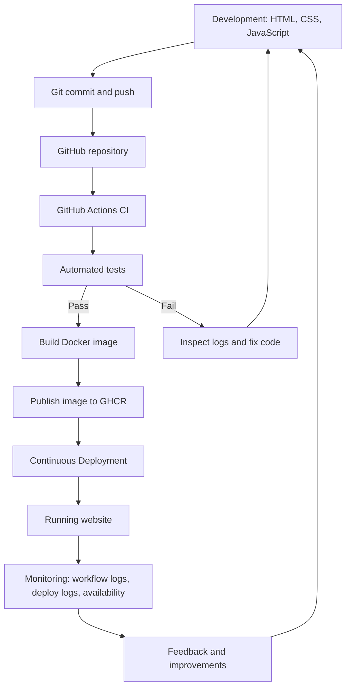

# DevOps pipeline flowchart

## Stage descriptions

1. **Development:** create and update the website.
2. **Version control:** Git records changes and GitHub hosts the repository.
3. **CI:** GitHub Actions starts automatically on a push or pull request.
4. **Automated testing:** Node.js test runner checks required files and expected behavior.
5. **Containerization:** Docker packages the static files with Nginx.
6. **CD:** the Docker image is published; optional deploy-hook integration triggers hosting deployment.
7. **Running application:** users open the deployed website URL.
8. **Monitoring and feedback:** inspect workflow/deployment logs, check availability, fix problems and improve the application.
